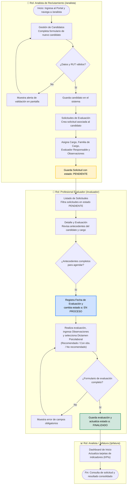

# AQUA-CONTRATOS 🐟📋

Sistema web para la centralización y digitalización del proceso de evaluación psicolaboral del área de Reclutamiento y Selección de **AquaChile**.

> **Proyecto Académico:** DSY1104 · Full Stack II  
> **Sección:** 002D  
> **Equipo:** Smiling Friends  
> **Integrantes:** Amaro Villalobos · Cristóbal Loncón · Joaquín Oyarzún · Luis Villalón  
> **Stack Principal:** React 19 · Vite · Bootstrap 5 · React Router 7 · Vitest · Node.js (Express + SQLite)  

---

## 📑 Índice

- [Problemática](#-problemática)
- [Solución](#-solución)
- [Roles y Permisos](#-roles-y-permisos)
- [Requisitos Funcionales y Estado](#-requisitos-funcionales-y-estado)
- [Flujo Principal del Proceso](#-flujo-principal-del-proceso)
- [Estructura del Repositorio](#-estructura-del-repositorio)
- [Cómo Ejecutar el Proyecto](#-cómo-ejecutar-el-proyecto)
- [Ejecución de Pruebas Unitarias (Vitest)](#-ejecución-de-pruebas-unitarias-vitest)
- [Diagnóstico Técnico y Estado de Correcciones](#-diagnóstico-técnico-y-estado-de-correcciones)
- [Entregables Académicos (EP2)](#-entregables-académicos-ep2)

---

## 🏢 Problemática

AquaChile es una empresa del rubro acuícola que desarrolla operaciones productivas y administrativas en distintas áreas de gestión. Dentro de sus procesos internos, el área de Reclutamiento y Selección requiere coordinar evaluaciones psicolaborales para candidatos que postulan a diversos cargos en plantas y oficinas.

Actualmente, el proceso se realiza mediante documentos físicos en papel y herramientas digitales dispersas. Como consecuencia, el flujo resulta lento, poco trazable y propenso a pérdidas de información entre los equipos de contratación, las jefaturas solicitantes y los evaluadores.

---

## 💡 Solución

**Aqua-Contratos** es una aplicación web Full Stack que centraliza y estandariza la información clave del proceso de evaluación psicolaboral:
- Registro y gestión de perfiles de candidatos con validación de RUT oficial (Módulo 11).
- Creación y seguimiento de solicitudes de evaluación con estados en tiempo real (*Pendiente*, *En proceso*, *Finalizado*).
- Registro de antecedentes, fechas de entrevista y calificaciones psicolaborales.
- Navegación declarativa SPA mediante **React Router 7**.
- Maquetación y estilos responsive con **Bootstrap 5**.
- Verificación de calidad mediante **25 pruebas unitarias automatizadas con Vitest**.
- Dashboard con indicadores operativos (KPIs) para jefaturas, evaluadores y analistas.

---

## 👥 Roles y Permisos

De acuerdo con el levantamiento del caso y las bases del MVP:

| Rol | Ruta | ¿Qué puede ver? | ¿Qué puede hacer? | Restricciones clave |
| :--- | :--- | :--- | :--- | :--- |
| **Analista de Reclutamiento** | `/analista` | Perfiles de candidatos, solicitudes de contratación y resultados finales. | Crear perfiles de candidatos, emitir solicitudes de evaluación y revisar informes psicolaborales. | No puede saltarse etapas del flujo ni emitir el dictamen clínico formal. |
| **Profesional Evaluador** | `/evaluador` | Solicitudes asignadas, datos laborales del candidato e historial de evaluaciones. | Agendar fechas de entrevista, actualizar estados a *En proceso*, registrar observaciones y dictar resultado general. | No toma la decisión final de contratación ni altera datos personales del candidato. |
| **Jefe de Área / Jefatura** | `/jefatura` | Dashboard con métricas agregadas y listado de solicitudes de su área (solo lectura). | Consultar el avance de evaluaciones solicitadas, solicitar informes de gestión y revisar resultados consolidados. | No crea, edita ni elimina candidatos o evaluaciones. |
| **Postulante a Trabajo** | `/candidato` | Ofertas laborales abiertas de plantas AquaChile y formulario de postulación. | Postular en línea con datos personales, adjuntar CV y obtener comprobante digital. | No accede a datos internos de otros postulantes ni a evaluaciones privadas. |

---

## 🎯 Requisitos Funcionales y Estado

Estado de implementación respecto al alcance del MVP:

| Código | Requisito Funcional | Prioridad | Estado Actual | Observaciones |
| :--- | :--- | :---: | :---: | :--- |
| **RF01** | Ingreso simple con usuarios ficticios o roles simulados | Alta | 🟢 Implementado | Implementado con **React Router 7** (`App.jsx`) y `HeaderRoles.jsx` para Analista, Evaluador, Jefatura y Postulante. |
| **RF02** | Registrar candidatos con datos mínimos obligatorios | Alta | 🟢 Implementado | Implementado en `ModalNuevaSolicitud.jsx` y `FormularioPostulacion.jsx` con validación de RUT (Módulo 11) y campos requeridos. |
| **RF03** | Editar y consultar información principal de un candidato | Alta | 🟢 Implementado | Implementado en `ModalDetalleSolicitud.jsx` y `ModalEditarCandidato.jsx`. |
| **RF04** | Crear solicitudes de evaluación asociadas a un candidato | Alta | 🟢 Implementado | Operativo desde el botón `+ Nueva solicitud` con vinculación de postulante y proceso. |
| **RF05** | Registrar cargo, familia de cargo, fecha de solicitud y responsable | Alta | 🟢 Implementado | Selectores de catálogo para plantas AquaChile, familias de cargo y evaluadores (`constantes.js`). |
| **RF06** | Visualizar listado de solicitudes y consultar su detalle | Alta | 🟢 Implementado | Listado con badges de estado Bootstrap 5 y visualización accesible desde el botón `Detalle`. |
| **RF07** | Buscar o filtrar solicitudes por estado, fecha, cargo o candidato | Media | 🟢 Implementado | Implementado en `BarraFiltros.jsx` y `solicitudesUtils.js` con buscador en tiempo real, filtro por estado, planta y evaluador. |
| **RF08** | Actualizar estado de la solicitud (*Pendiente*, *En proceso*, *Finalizado*) | Alta | 🟢 Implementado | Selector de cambio de estado interactivo con persistencia global entre vistas. |
| **RF09** | Registrar fecha de evaluación, observaciones o resultado general | Alta | 🟢 Implementado | Formulario formal validado en `ModalDetalleSolicitud.jsx` con fecha, dictamen y observaciones clínicas. |
| **RF10** | Dashboard simple con indicadores generales del proceso | Media | 🟢 Implementado | KPIs calculados dinámicamente en tiempo real (`calcularIndicadores`) en tarjetas responsive de Bootstrap 5 (`IndicadorCard.jsx`). |

---

## 🔄 Flujo Principal del Proceso



---

## 📁 Estructura del Repositorio

```
Aqua-Contratos/
├── CONTRIBUTING.md           # Normas de contribución y convenciones
├── README.md                 # Documentación integral del proyecto
├── DSY1104_Evaluacion_Parcial_2_Rubrica_VcM_React.pdf
├── evidencias/               # Documentos oficiales y entregables solicitados
│   ├── ERS_AquaContratos_EP2.md              # Documento ERS actualizado (alcance y requerimientos)
│   ├── Evidencia_Pruebas_Vitest_EP2.md       # Informe formal de testing automatizado (Vitest)
│   ├── Guia_Defensa_Presentacion_EP2.md      # Guía maestra de defensa técnica (60% individual)
│   └── Fullstack-Actividad_Bases_MVP_AquaChile_DSY1104.docx.pdf
├── backend/                  # API REST en Node.js + Express (Etapa Full Stack)
│   ├── package.json
│   ├── README.md
│   └── src/
└── vcm-psicolaboral/         # Frontend React + Vite + Bootstrap 5 + Vitest
    ├── index.html            # Plantilla HTML base
    ├── vite.config.js        # Configuración de Vite y Vitest (jsdom)
    ├── package.json          # Dependencias (react-router-dom, bootstrap, vitest, testing-library)
    └── src/
        ├── main.jsx          # Punto de entrada con Bootstrap 5 y ReactDOM
        ├── App.jsx           # Enrutamiento declarativo SPA (React Router 7) y selectores de portal
        ├── index.css         # Variables y estilos complementarios
        ├── test/             # Suites de pruebas automatizadas Vitest (25 tests)
        │   ├── setup.js              # Configuración de jest-dom
        │   ├── calcularRut.test.js   # Pruebas de validación Módulo 11, RUT completo y edad (8 tests)
        │   ├── indicadores.test.js   # Pruebas de cálculo de métricas del Dashboard (2 tests)
        │   ├── filtros.test.js       # Pruebas de búsqueda y filtros reactivos (6 tests)
        │   ├── components.test.jsx   # Pruebas de componentes, validación modal y Bootstrap (7 tests)
        │   └── router.test.jsx       # Pruebas de navegación React Router (2 tests)
        ├── pages/            # Vistas principales vinculadas a rutas
        │   ├── AnalistaPage.jsx
        │   ├── EvaluadorPage.jsx
        │   ├── JefaturaPage.jsx
        │   └── CandidatoPage.jsx
        ├── components/       # Componentes modulares reutilizables
        ├── services/         # Servicios de persistencia (localStorage) y conexión API
        └── utils/            # Funciones auxiliares (calcularRut, solicitudesUtils, constantes, visorCv)
```

---

## 🚀 Cómo Ejecutar el Proyecto

### Prerrequisitos
- Tener instalado **[Node.js](https://nodejs.org/)** (v18, v20 o v24).
- Gestor de paquetes **npm**.

### Pasos de puesta en marcha

1. **Instalar dependencias de todo el proyecto:**
   ```bash
   npm run install:all
   ```

2. **Iniciar el servidor de desarrollo del frontend:**
   ```bash
   npm run dev:frontend
   # o desde la carpeta: cd vcm-psicolaboral && npm run dev
   ```

3. **Acceder a la aplicación en el navegador:**
   👉 **[http://localhost:5173](http://localhost:5173)**

---

## 🧪 Ejecución de Pruebas Unitarias (Vitest)

Para ejecutar la suite completa de **25 pruebas automatizadas** exigidas en la rúbrica (**IE2.2.1 / IE2.2.2**):

```bash
# Ejecutar todas las pruebas (modo single run)
npm test

# O directamente en el frontend:
cd vcm-psicolaboral
npm test

# Modo observador interactivo:
npm --prefix vcm-psicolaboral run test:watch
```

Resultado esperado:
```text
 ✓ src/test/calcularRut.test.js (8 tests)
 ✓ src/test/indicadores.test.js (2 tests)
 ✓ src/test/filtros.test.js (6 tests)
 ✓ src/test/components.test.jsx (7 tests)
 ✓ src/test/router.test.jsx (2 tests)

 Test Files  5 passed (5)
      Tests  25 passed (25)
   Duration  ~2.0s
```

---

## 🛠️ Diagnóstico Técnico y Estado de Correcciones

Estado del proyecto tras adecuarlo a la rúbrica de la Evaluación Parcial 2:

1. **Navegación SPA con React Router 7:**  
   🟢 **Cumplido al 100%:** Navegación declarativa mediante rutas formales (`/`, `/empleados`, `/analista`, `/evaluador`, `/jefatura`, `/candidato`, `/postular`) con persistencia sincronizada en `localStorage` al cambiar entre roles.
2. **Estilos y Maquetación Responsive con Bootstrap 5:**  
   🟢 **Cumplido al 100%:** Bootstrap 5 instalado e integrado en `main.jsx`. Implementadas clases de grid responsive (`container-fluid`, `row`, `col-*`), tarjetas (`card`), tablas (`table-responsive`, `table-hover`), badges contextuales (`bg-warning`, `bg-primary`, `bg-success`) y controles de formulario (`form-control`, `form-select`).
3. **Testing Automatizado con Vitest:**  
   🟢 **Cumplido al 100%:** Vitest configurado con entorno `jsdom` y Testing Library. **25 pruebas unitarias** ejecutando código real de `src/utils/` y `src/components/` con 0 errores.
4. **Documentación Oficial y Entregables:**  
   🟢 **Cumplido al 100%:** Redactados el documento formal de ERS, el reporte de Evidencias de Pruebas Vitest y la Guía de Defensa Técnica en la carpeta `evidencias/`.

---

## 📑 Entregables Académicos (EP2)

1. **Código fuente:** En el repositorio GitHub en la rama principal.
2. **README de ejecución:** Presente en la raíz del repositorio.
3. **Documento ERS actualizado:** [`evidencias/ERS_AquaContratos_EP2.md`](evidencias/ERS_AquaContratos_EP2.md).
4. **Evidencia breve de pruebas Vitest:** [`evidencias/Evidencia_Pruebas_Vitest_EP2.md`](evidencias/Evidencia_Pruebas_Vitest_EP2.md).
5. **Guía de Defensa Técnica Individual:** [`evidencias/Guia_Defensa_Presentacion_EP2.md`](evidencias/Guia_Defensa_Presentacion_EP2.md).
