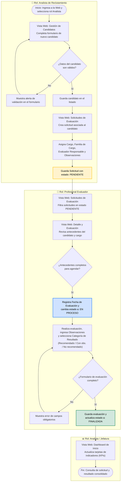

# AQUA-CONTRATOS 🐟📋

Sistema web para la centralización y digitalización del proceso de evaluación psicolaboral del área de Reclutamiento y Selección de **AquaChile**.

> **Proyecto Académico:** DSY1104 · Full Stack II  
> **Sección:** 002D  
> **Equipo:** Smiling Friends  
> **Integrantes:** Amaro Villalobos · Cristóbal Loncón · Joaquín Oyarzún · Luis Villalón  
> **Stack Principal:** React 19 · Vite · Node.js  

---

## 📑 Índice

- [Problemática](#-problemática)
- [Solución](#-solución)
- [Roles y Permisos](#-roles-y-permisos)
- [Requisitos Funcionales y Estado](#-requisitos-funcionales-y-estado)
- [Flujo Principal del Proceso](#-flujo-principal-del-proceso)
- [Estructura del Repositorio](#-estructura-del-repositorio)
- [Cómo Ejecutar el Proyecto](#-cómo-ejecutar-el-proyecto)
- [Diagnóstico Técnico y Errores Conocidos](#-diagnóstico-técnico-y-errores-conocidos)
- [Convenciones de Estilo y CSS](#-convenciones-de-estilo-y-css)
- [Roadmap de Desarrollo](#-roadmap-de-desarrollo)

---

## 🏢 Problemática

AquaChile es una empresa del rubro acuícola que desarrolla operaciones productivas y administrativas en distintas áreas de gestión. Dentro de sus procesos internos, el área de Reclutamiento y Selección requiere coordinar evaluaciones psicolaborales para candidatos que postulan a diversos cargos en plantas y oficinas.

Actualmente, el proceso se realiza mediante documentos físicos en papel y herramientas digitales dispersas. Como consecuencia, el flujo resulta lento, poco trazable y propenso a pérdidas de información entre los equipos de contratación, las jefaturas solicitantes y los evaluadores.

---

## 💡 Solución

**Aqua-Contratos** es una aplicación web Full Stack que centraliza y estandariza la información clave del proceso de evaluación psicolaboral:
- Registro y gestión de perfiles de candidatos.
- Creación y seguimiento de solicitudes de evaluación con estados en tiempo real.
- Registro de antecedentes, fechas de entrevista y calificaciones psicolaborales.
- Dashboard con indicadores operativos (KPIs) para jefaturas y analistas.

---

## 👥 Roles y Permisos

De acuerdo con el levantamiento del caso y las bases del MVP:

| Rol | ¿Qué puede ver? | ¿Qué puede hacer? | Restricciones clave |
| :--- | :--- | :--- | :--- |
| **Analista de Reclutamiento** | Perfiles de candidatos, solicitudes de contratación y resultados finales. | Crear perfiles de candidatos, emitir solicitudes de evaluación y revisar informes psicolaborales. | No puede saltarse etapas del flujo ni duplicar perfiles de una misma persona. |
| **Profesional Evaluador** | Solicitudes asignadas, datos laborales del candidato e historial de evaluaciones. | Agendar fechas de entrevista, actualizar estados a *En proceso*, registrar observaciones y dictar resultado general. | No toma la decisión final de contratación ni altera datos personales del candidato. |
| **Jefe de Área / Jefatura** | Dashboard con métricas agregadas y listado de solicitudes de su área (solo lectura). | Consultar el avance de evaluaciones solicitadas y revisar resultados consolidados. | No crea, edita ni elimina candidatos o evaluaciones. |
| **Administrador Académico** | Todas las vistas, catálogos base y usuarios simulados. | Alternar entre roles simulados y gestionar datos base de prueba para demostración del MVP. | No ingresar datos sensibles o reales de trabajadores de la empresa. |

---

## 🎯 Requisitos Funcionales y Estado

Estado de implementación respecto al alcance del MVP:

| Código | Requisito Funcional | Prioridad | Estado Actual | Observaciones |
| :--- | :--- | :---: | :---: | :--- |
| **RF01** | Ingreso simple con usuarios ficticios o roles simulados | Alta | 🟢 Implementado | Implementado en `HeaderRoles.jsx` con selector para Analista, Evaluador y Jefatura. |
| **RF02** | Registrar candidatos con datos mínimos obligatorios | Alta | 🟢 Implementado | Implementado en `ModalNuevaSolicitud.jsx` con captura y validación de campos obligatorios. |
| **RF03** | Editar y consultar información principal de un candidato | Alta | 🟢 Implementado | Implementado en `ModalDetalleSolicitud.jsx` con antecedentes completos del postulante. |
| **RF04** | Crear solicitudes de evaluación asociadas a un candidato | Alta | 🟢 Implementado | Operativo desde el botón `+ Nueva solicitud` con vinculación de postulante y proceso. |
| **RF05** | Registrar cargo, familia de cargo, fecha de solicitud y responsable | Alta | 🟢 Implementado | Selectores de catálogo para plantas AquaChile, familias de cargo y evaluadores. |
| **RF06** | Visualizar listado de solicitudes y consultar su detalle | Alta | 🟢 Implementado | Listado con CSS Grid y visualización detallada accesible desde el botón `Detalle`. |
| **RF07** | Buscar o filtrar solicitudes por estado, fecha, cargo o candidato | Media | 🟢 Implementado | Implementado en `BarraFiltros.jsx` con buscador en tiempo real, filtro por estado y por planta. |
| **RF08** | Actualizar estado de la solicitud (*Pendiente*, *En proceso*, *Finalizada*) | Alta | 🟢 Implementado | Selector de cambio de estado interactivo disponible en el modal de detalle. |
| **RF09** | Registrar fecha de evaluación, observaciones o resultado general | Alta | 🟢 Implementado | Formulario formal de evaluación en `ModalDetalleSolicitud.jsx` con fecha, dictamen y observaciones. |
| **RF10** | Dashboard simple con indicadores generales del proceso | Media | 🟢 Implementado | 4 KPIs calculados dinámicamente en tiempo real según el estado de las solicitudes. |

---

## 🔄 Flujo Principal del Proceso



---

## 📁 Estructura del Repositorio

```
Aqua-Contratos/
├── CONTRIBUTING.md           # Normas de contribución y convenciones de CSS
├── README.md                 # Documentación integral del proyecto
├── evidencias/               # Documentación y pautas académicas del caso
│   └── Fullstack-Actividad_Bases_MVP_AquaChile_DSY1104.docx.pdf
├── backend/                  # Capa de servicios y API REST (Node.js + Express)
│   ├── package.json          # Dependencias (express, cors, dotenv)
│   ├── README.md             # Especificación detallada de endpoints REST
│   └── src/
│       ├── app.js            # Configuración Express y middlewares
│       ├── index.js          # Arranque del servidor (puerto 4000)
│       ├── controllers/      # Controladores (candidatos, solicitudes, dashboard)
│       ├── routes/           # Rutas API (/api/candidatos, /api/solicitudes, /api/dashboard)
│       ├── data/             # Semilla y dataStore en memoria
│       └── middlewares/      # Manejadores de errores y 404
└── vcm-psicolaboral/         # Frontend de la aplicación (React + Vite)
    ├── index.html            # Plantilla HTML base
    ├── vite.config.js        # Configuración de compilación Vite
    ├── package.json          # Dependencias y scripts npm
    ├── eslint.config.js      # Reglas de linting (ESLint 10 flat config)
    ├── public/               # Archivos estáticos públicos (favicons, SVG)
    └── src/
        ├── main.jsx          # Punto de entrada de React (createRoot)
        ├── App.jsx           # Componente contenedor principal
        ├── index.css         # Variables de diseño y estilos globales
        ├── pages/
        │   └── DashBoardPage.jsx        # Página del Dashboard operativo
        └── components/
            ├── BotonOrange.jsx          # Botón reutilizable con animación hover y soporte click
            ├── IndicadorCard.jsx        # Tarjeta para visualización de KPIs
            ├── CandidatosRecientes.jsx  # Fila individual de tabla con badges de estado
            ├── HeaderRoles.jsx          # Barra superior con selector de rol y pestañas de navegación (RF01) - Autor: Amaro
            ├── BarraFiltros.jsx         # Barra de búsqueda y filtros en tiempo real (RF07) - Autor: Amaro
            ├── GestionCandidatosView.jsx# Vista web dedicada para gestión y catálogo de candidatos (RF02, RF03) - Autor: Amaro
            ├── ModalNuevaSolicitud.jsx  # Formulario modal para nuevo candidato y solicitud (RF02, RF04, RF05) - Autor: Amaro
            ├── ModalEditarCandidato.jsx # Formulario modal para modificar información de candidato (RF03) - Autor: Amaro
            ├── ModalDetalleSolicitud.jsx# Modal de consulta, rúbrica y dictamen psicolaboral (RF03, RF06, RF08, RF09) - Autor: Amaro
            └── columnasTabla.js         # Configuración de distribución de columnas Grid
```

---

## 🚀 Cómo Ejecutar el Proyecto

### Prerrequisitos
- Tener instalado **[Node.js](https://nodejs.org/)** (versión 18 LTS o superior, recomendado v20/v22).
- Gestor de paquetes **npm** (incluido automáticamente con Node.js).

> **Verificación previa:** Comprueba que Node.js esté disponible en tu terminal ejecutando:
> ```bash
> node -v
> npm -v
> ```
> *Si el comando no se reconoce, instala Node.js vía [sitio oficial](https://nodejs.org/) o mediante PowerShell con `winget install OpenJS.NodeJS.LTS` y reinicia tu terminal.*

### Pasos de instalación y puesta en marcha

1. **Navegar a la carpeta del frontend:**
   ```bash
   cd vcm-psicolaboral
   ```

2. **Instalar dependencias:**
   ```bash
   npm install
   ```

3. **Iniciar el servidor de desarrollo:**
   ```bash
   npm run dev
   ```

4. **Acceder a la aplicación:**
   Abre tu navegador en:
   👉 **[http://localhost:5173](http://localhost:5173)**

### Scripts adicionales
| Comando | Descripción |
| :--- | :--- |
| `npm run build` | Compila la versión de producción optimizada en la carpeta `dist`. |
| `npm run preview` | Levanta un servidor local para probar la versión de producción compilada. |
| `npm run lint` | Ejecuta el análisis estático de código con ESLint para detectar errores de sintaxis y buenas prácticas. |

---

## 🛠️ Diagnóstico Técnico y Estado de Correcciones

Estado tras auditorías y refactorizaciones del código:

1. **Imports no utilizados de JSX Runtime:**  
   🟢 **Resuelto:** Eliminadas importaciones espurias de `_jsxDEV`.
2. **Error tipográfico en nombre de componente:**  
   🟢 **Resuelto:** Archivo renombrado a `CandidatosRecientes.jsx` con importaciones actualizadas.
3. **Variable CSS mal posicionada:**  
   🟢 **Resuelto:** `--radio-cuadros: 8px;` y demás variables de diseño organizadas dentro de `:root` en `index.css`.
4. **Navegación e interactividad de enlaces:**  
   🟢 **Resuelto:** Interacciones de botones (+ Nueva solicitud, Detalle, Editar) enlazadas mediante modales dinámicos y pestañas de vista.
5. **Capa Backend, API REST y Persistencia:**  
   🟢 **Resuelto:** Servidor Node.js + Express completamente integrado, API REST funcional, persistencia relacional con **SQLite** nativo y cliente HTTP conectado en React (`src/services/api.js`) con fallback inteligente.

---

## 🎨 Convenciones de Estilo y CSS

Según lo estipulado en [CONTRIBUTING.md](file:///C:/Users/Usuario/OneDrive/Desktop/Aqua-Contratos/CONTRIBUTING.md):

1. **Variables en `:root`:** Todo color o medida reutilizable debe declararse como variable CSS dentro del bloque `:root` en `src/index.css`.
2. **Nombres de variables:** Deben contener entre **2 y 3 palabras** representativas (ejemplo: `--fondo-cuadros`, `--radio-cuadros`, `--borde-boton-hover`).
3. **Uso de clases vs. estilos en línea:** Se recomienda migrar los estilos en línea (`style={{ ... }}`) a clases CSS en `index.css` o módulos para permitir el uso directo de `var(--nombre-variable)` y facilitar el mantenimiento.

---

## 🗺️ Roadmap de Desarrollo

- [x] **Fase 1: Correcciones inmediatas y limpieza técnica**
  - [x] Eliminar imports espurios de `_jsxDEV`.
  - [x] Corregir typo en `CandidatosRecientes.jsx`.
  - [x] Reorganizar variables CSS en `:root`.
- [x] **Fase 2: Arquitectura y Navegación**
  - [x] Configurar selector de rol activo en la cabecera (RF01).
  - [x] Implementar enrutamiento o navegación por pestañas/modales interactivos.
- [x] **Fase 3: Funcionalidades del MVP (Frontend Completo)**
  - [x] Métricas dinámicas en el Dashboard basadas en datos en tiempo real (RF10).
  - [x] Formulario modal de nuevo candidato y emisión de solicitud (RF02, RF04, RF05).
  - [x] Vista modal de Detalle y selector de cambio de estado (RF03, RF06, RF08).
  - [x] Buscador y filtros de solicitudes por estado/cargo/candidato (RF07).
  - [x] Interfaz dedicada de Evaluación psicológica con dictamen y rúbrica (RF09).
- [x] **Fase 4: Backend y Persistencia**
  - [x] Diseñar estructura de carpetas modular (`controllers`, `routes`, `dataStore`).
  - [x] Definir especificación de la API REST (`/api/candidatos`, `/api/solicitudes`, `/api/dashboard`).
  - [x] Configurar servidor Express con CORS y manejo centralizado de errores.
  - [x] Conectar frontend (cliente HTTP en `api.js` conectado a `DashBoardPage.jsx`).
  - [x] Integrar motor de base de datos persistente (SQLite nativo con esquema SQL relacional y persistencia en disco).

