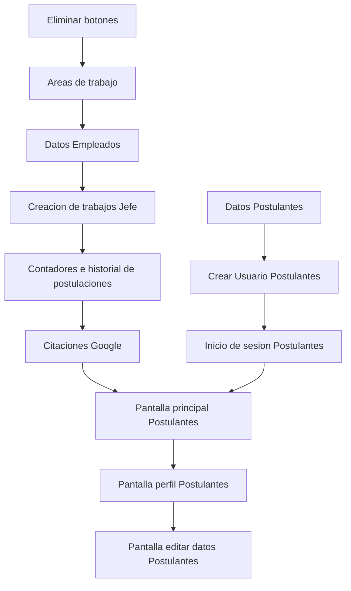

# Aqua-Contratos | Planteamiento teorico

Actualmente la pagina tiene las siguentes pantallas

- Portal de entrada (Empleados o Postulantes)
- Portal Empleados (Analista / Evaluador / Jefes)
- Pantalla Empleado (Analista / Evaluador / Jefes)
- Postulantes

Los portales simplemente dividen a los usuarios segun los grupos a los que correspondan.

El grueso del trabajo se realiza en las pantallas dedicadas a los usuarios, ya que es donde se acceso a todas las funciones disponibles en la version actual

- [Version Actual](#version-actual)
    - [Pantalla postulantes](#pantalla-postulantes)
    - [Pantalla Jefatura](#pantalla-jefatura)
    - [Pantalla Evaluador / Analista](#pantalla-evaluador--analista)
    - [Informes](#informes)
- [Cambios a realizar](#cambios-a-realizar)
    - [Cambio / Postulantes y candidatos](#cambio--postulantes-y-candidatos)
    - [Mejora / Informes + Evaluacion Psicolaboral](#mejora--informes--evaluacion-psicolaboral)
    - [Novedad / Cuentas de postulantes](#novedad--cuentas-de-postulantes)
    - [Novedad / Citaciones reales](#novedad--citaciones-reales)
    - [Novedad / Segregacion de areas](#novedad--segregacion-de-areas)
    
## Version actual

### Pantalla postulantes

Los postulantes deben completar un formulario para ser registrados en la base de datos, necesitando los siguentes datos:
- Rut (Dividido por "cuerpo" y verificador)
- Nombre
- Apellido
- Direccion
- E-mail
- Comuna
- *Cargo 
- Fecha de nacimiento
- Curricumul

Todos los datos son obligatorios para realizar una postulación

Cargo tiene un comportamiento bastante torpe, actualmente puedes pulsar cualquier trabajo disponible para agregarlo, pero solo uno a la vez, ya que el atributo se modifica a travez de una caja de texto que termina siendo sobreescrita.

Tambien existen 3 numeros arriba: Ofertas Abiertas, Vacantes Totales y postulaciones enviadas, ademas de ofertas en la parte inferior, junto a una caja que hace seguimiento de todas las postulaciones realizadas

### Pantalla Jefatura
En la parte superior hay 5 contadores
- Candidatos Totales
- Solicitudes pendientes
- En proceso
- Evaluaciones Finalizadas
- Informes Solicitados
Estos son dinamicos, ya que se actualizan, y son compartidos con los analistas y evaluadores, con la excepcion de Informes Solicitados.

### Pantalla Evaluador / Analista

Evaluador es el unico usuario que puede manipular el estado de postulacion de los postulantes

Evaluador realiza las evaluaciones psicolaborales y puede afirmar que el postulante fue recomendado

Tanto analista como evaluador pueden constestar las preguntas adicionales que realice el jefe a travez de un informe

#### Informes

Es una funcion deoendiente del jefe, este puede elegir a cualquier postulante para realizar preguntas sobre el mismo, las cuales son respondidas por el analista y/o el evaluador
Los informes tienen 4 niveles de urgencia, ademas de una fecha limite no excluyente, es decir, no bloquea las respuestas tardias
El jefe puede cerrar o reabrir los informes en cualquier momento 

## Cambios a realizar

### ¡¡¡Eliminar +Nueva solicitud y +Registrar postulante!!!

Estos botones crean postulantes en las pantallas de los empleados, lo que no sera parte del flujo final

### Novedad / Cuentas de postulantes

Cada usuario debe crear una cuenta en la pagina. Debemos considerar varios puntos para las mismas

#### Postulantes

- Seguridad
- Contraseñas
- Privacidad
- Actualizacion de datos agil
- Lista de postulaciones en proceso
- Citas con Aquachile

No agregaremos un historial de postulaciones para el usuario, ya que los trabajos eventualmente desaparecen del sistema

#### Empleados

Jefes
- Creacion, edicion y eliminacion de trabajos para postulacion

#### Trabajos en la pagina

Se mantendra la estructura de datos para un trabajo actual, agregando datos como

- Fecha de creacion del trabajo
- Conteo de modificaciones
- Historial de modificaciones

Estos datos estan pensados para que se pueda modificar las condiciones de los trabajos postulados, mientras se mantiene la transparencia con los postulantes

### Novedad / Segregacion de areas

Cada area de trabajo en Aquachile tiene su propia jefatura, por ende asumiremos que la falta de personal en una no necesariamente compete en otra, por ello se tomaran medidas adicionales
- Los jefes seran identificados por su area
- Solo podran interactuar directamente con los postulantes en trabajos de su area
- Solo pueden crear areas que competan a su area

### Cambio / Postulantes y candidatos

Las 4 secciones actuales se reduciran a 2

Lista de postulantes: Todos los usuarios que se registraron a la página
Lista de candidatos: Lista filtrada por usuarios que se han postulado a un puesto de trabajo

### Mejora / Informes + Evaluacion Psicolaboral

Para agilizar el acceso a la informacion de los postulantes se fusionaran ambas funciones, dando acceso a las 2 en la misma ventana emergente.

### Novedad / Citaciones reales

En clases se presentaron herramientas reales para coordinacion de citas a travez de Google.

Todos los empleados pueden realizar citaciones, y se tendra en cuenta los siguientes tipos:

- Entrevistas fisicas
- Entrevistas online
- Inscripciones a la escuela de buceo
- Firma de papeles
- Entrega de papeles

Junto a otras fechas que pueden ser competentes:

- Cierres de local
- Vacaciones y permisos
- Mantenimientos y sanitizaciones
- Feriados

Ademas se agregara una seccion ``Calendario``, en la misma se podra planear con mayor facilidad las citaciones que hagan falta

## Funciones fuera de scope

- Chat con postulantes
- Chat entre empleados
- Configuraciones de usuario
- Barra lateral

